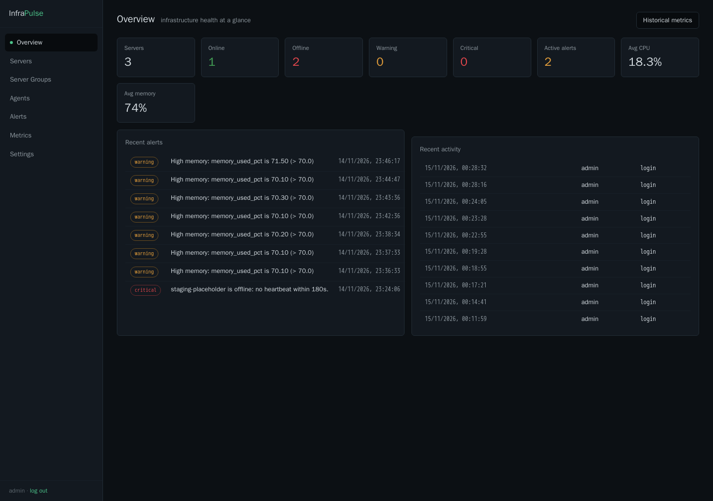
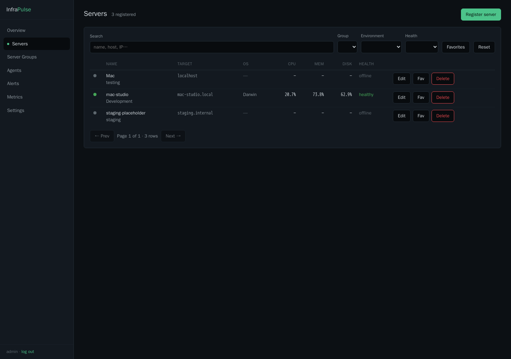
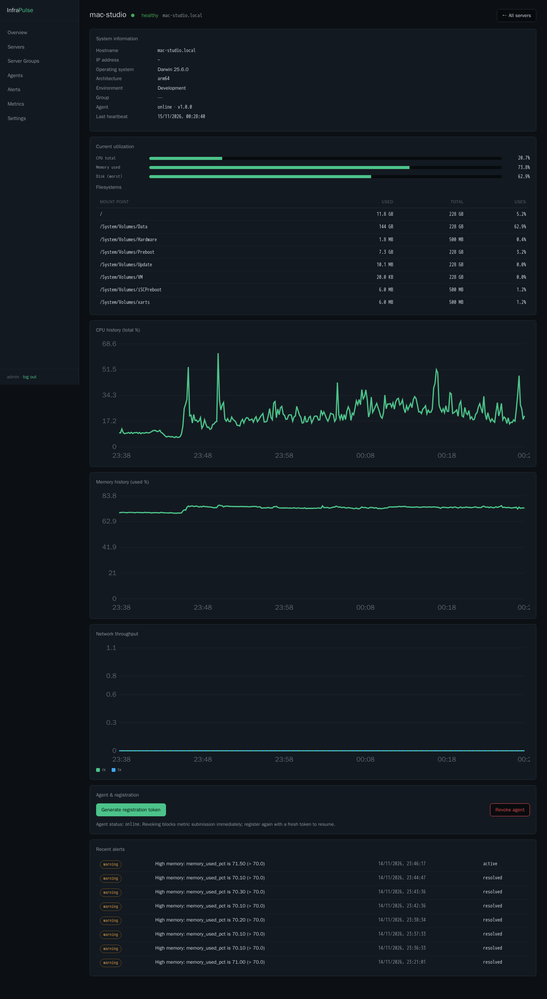
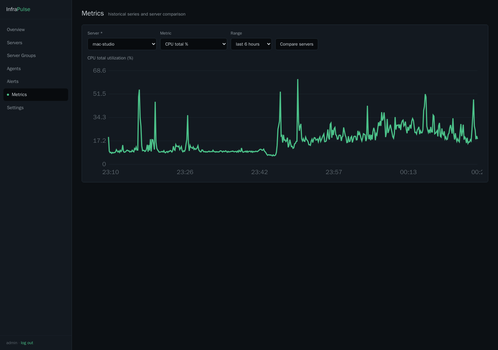
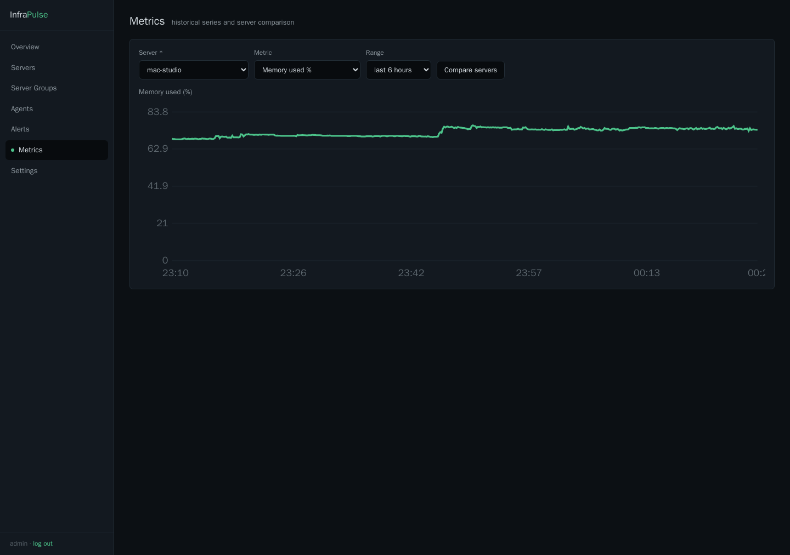
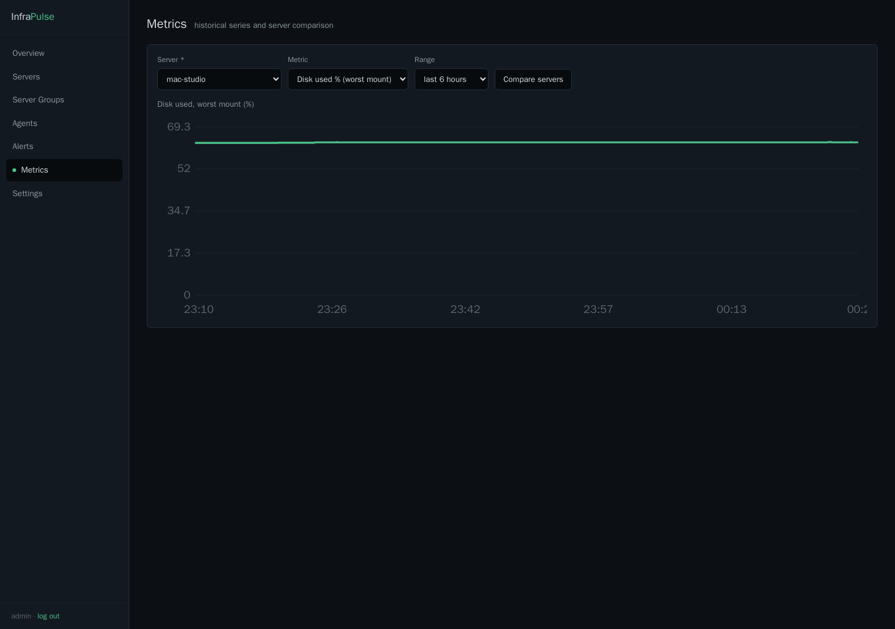
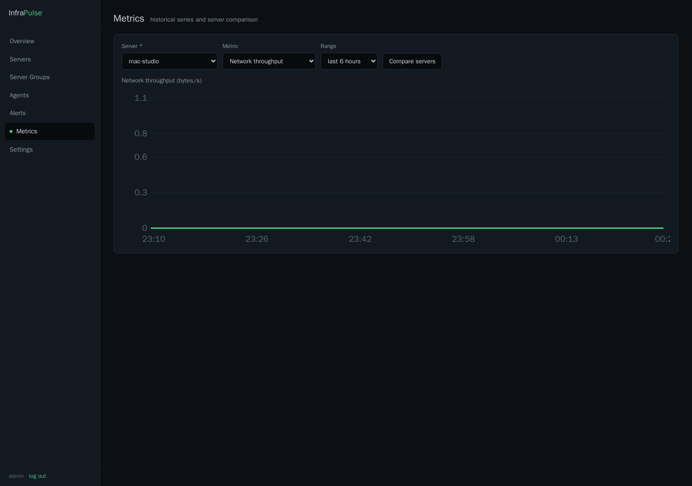
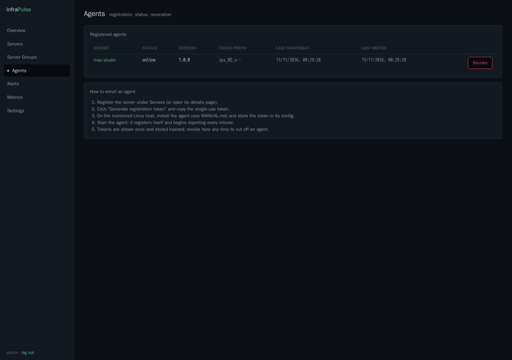
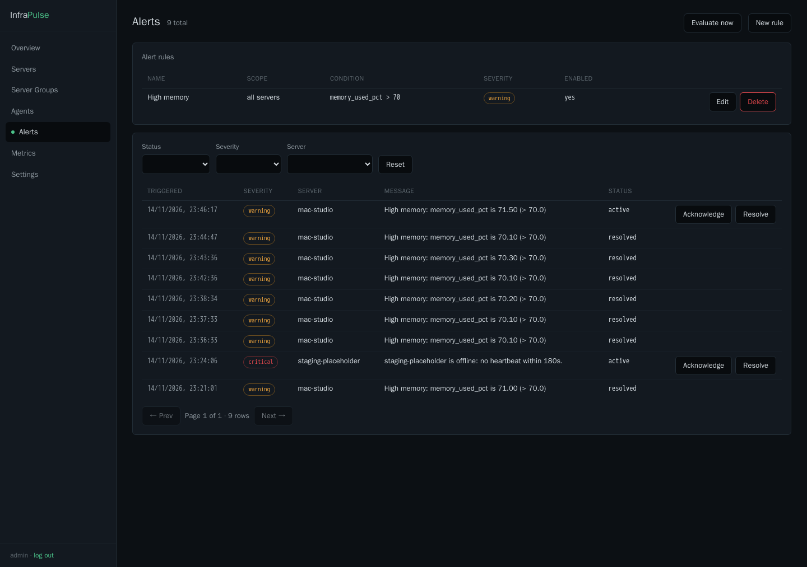
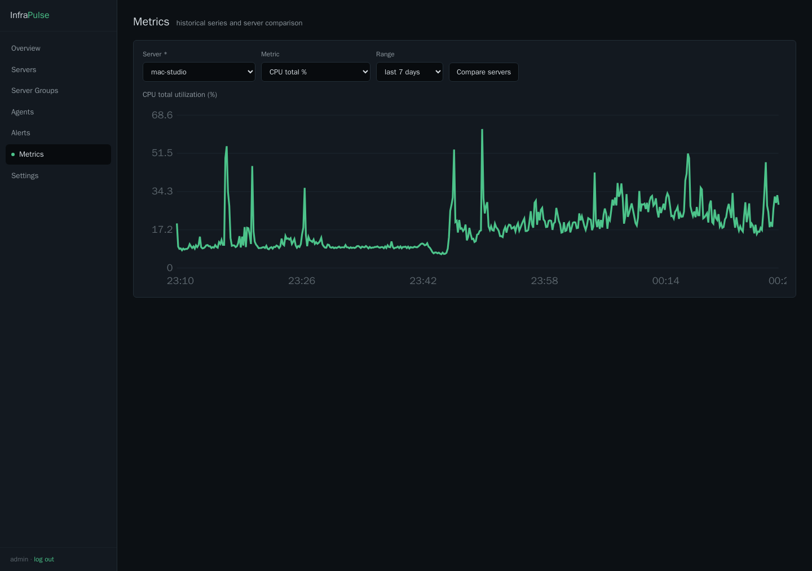

# InfraPulse

A modern, self-hosted infrastructure monitoring platform for tracking multiple Linux servers from a centralized dashboard: real metrics from lightweight agents, health evaluation, historical charts and configurable alerting.

## Quick start

Prerequisites: Docker and Docker Compose v2.

```sh
cp .env.example .env   # then set ADMIN_USERNAME / ADMIN_PASSWORD
./start.sh             # Linux
./start.command        # macOS (double-click works too)
start.bat              # Windows
```

Then open [http://localhost:8092](http://localhost:8092) in a browser.
API docs: [http://localhost:8003/api/docs](http://localhost:8003/api/docs).

See [MANUAL.md](MANUAL.md) for installation, agent setup (systemd included), configuration, testing and troubleshooting — or the printable **[InfraPulse User Manual (PDF)](docs/InfraPulse-Manual.pdf)** with annotated screenshots.

## Screenshots

Real captures of the running application with a live reporting agent (plus one offline demo server):

### Dashboard



### Servers



### Server details



### CPU monitoring



### Memory monitoring



### Disk monitoring



### Network monitoring



### Agents



### Alerts



### Historical metrics



## Features

- **Overview dashboard** — servers, online/offline, warnings, criticals, active alerts, average CPU/memory, storage totals, recent alerts and activity. Empty states when nothing is registered.
- **Servers** — full CRUD, groups, environments, favorites, search/filter (name, host, IP, group, environment, health), per-server health with reasons, live CPU/memory/disk readings. Deleting cascades metrics, alerts and agent credentials.
- **Monitoring agent** — Python + psutil, stdlib HTTP, ~10s cadence configurable; collects CPU (total + per-core + load), memory (+ swap), all filesystems, per-interface counters, system info. systemd unit included. Only the documented metrics — no shell, no remote control.
- **Agent management** — single-use registration tokens (shown once, 24h expiry), hashed agent credentials, status/heartbeat/version tracking, one-click revocation, rotation by re-registration.
- **Metric history** — per-kind series with time ranges, newest-value lookups for gauges/disks/interfaces, server comparison, throughput derived from counter deltas (never raw counters).
- **Health engine** — centralized thresholds (`.env`), statuses healthy/warning/critical/offline/unknown with reasons; offline on stale heartbeat.
- **Alerting** — per-server or global threshold rules with operators, severities, cooldowns and dedup (one active incident per rule/server); offline incidents with auto-resolution; in-app notifications; manual + cron-friendly `POST /api/alerts/evaluate`.
- **Retention** — configurable (default 30 days), probabilistic cleanup on ingest, no extensions required.
- **Dark NOC UI** — dense Vue 3 + TypeScript SPA (light theme optional in Settings).

## Technology stack

| Layer | Choice |
|---|---|
| Frontend | Vue 3, TypeScript, Composition API, Vite, Pinia, Vue Router |
| Backend | Python 3.13, FastAPI, Pydantic v2, SQLAlchemy 2, uv |
| Database | PostgreSQL 17 (versioned SQL migrations, no extensions) |
| Agent | Python 3.10+, psutil, stdlib HTTP |
| Infra | Docker, Docker Compose |

## Architecture overview

```text
monitored hosts (agent, outbound HTTPS only)
        │  POST /api/agent/register|metrics|heartbeat (token auth)
        ▼
browser → frontend (nginx, :8092) → /api/* → backend (FastAPI, :8003) → db (PostgreSQL 17)
```

Three Compose services on an internal network with health checks and a
persistent `pgdata` volume. The backend applies SQL migrations on boot,
bootstraps the admin, evaluates alerts on ingest, and resolves offline
incidents on heartbeat. Agents never touch the database.

## Project structure

```text
infrapulse/
├── backend/               # FastAPI app (uv-managed)
│   ├── app/               # config, database, models, schemas, health,
│   │   │                  # alerting, ingest, auth, migrate, main
│   │   └── routers/       # health, auth, groups, servers, agents,
│   │                      # ingest (agent API), metrics, alerts, dashboard
│   ├── migrations/        # versioned SQL (0001_initial)
│   └── tests/             # pytest: health, API, ingest, alerts (SQLite)
├── agent/                 # monitoring agent (uv-managed)
│   ├── src/infrapulse_agent/  # config, collect, client, __main__
│   ├── systemd/           # infrapulse-agent.service
│   └── tests/             # pytest with mocked psutil/HTTP
├── frontend/              # Vue 3 + TS SPA (npm)
│   └── src/               # views, components, api client, stores, utils
├── samples/               # agent config example
├── docs/screenshots/      # real UI captures
├── compose.yaml           # db + backend + frontend services
├── Dockerfile             # backend image
├── start.sh / start.command / start.bat
└── MANUAL.md / AGENTS.md / README.md
```

## Configuration

Copy `.env.example` to `.env`. Required: `ADMIN_USERNAME`, `ADMIN_PASSWORD`.
Tuning (centralized health/retention, see [MANUAL.md](MANUAL.md) §5):

| Variable | Default |
|---|---|
| `METRIC_RETENTION_DAYS` | `30` |
| `HEARTBEAT_GRACE_SECONDS` | `180` |
| `CPU_WARN_PCT` / `CPU_CRIT_PCT` | `75` / `90` |
| `MEM_WARN_PCT` / `MEM_CRIT_PCT` | `80` / `95` |
| `DISK_WARN_PCT` / `DISK_CRIT_PCT` | `80` / `95` |
| `BACKEND_PORT` / `FRONTEND_PORT` | `8003` / `8092` |

Never commit a real `.env` file.

## API documentation

Base path `/api`. Interactive reference at `/api/docs`. User routes need a
bearer token; agent routes need an agent token.

- `POST /api/auth/login` · `GET /api/auth/me` · admin `GET|POST /api/auth/users`, `DELETE /api/auth/users/{id}`
- Servers: `GET|POST /api/servers` (search/filter/pagination) · `GET|PUT|DELETE /api/servers/{id}` · `PATCH /api/servers/{id}/favorite`
- Groups: `GET|POST /api/groups` · `PUT|DELETE /api/groups/{id}`
- Agents: `GET /api/agents` (+`/{id}`) · `POST /api/servers/{id}/registration-token` · `DELETE /api/agents/{id}`
- Agent API: `POST /api/agent/register` · `POST /api/agent/metrics` · `POST /api/agent/heartbeat`
- `GET /api/metrics/series|latest|compare` · `GET /api/dashboard/summary`
- Rules: `GET|POST /api/alert-rules` · `PUT|DELETE /api/alert-rules/{id}`
- Alerts: `GET /api/alerts` · `POST /api/alerts/{id}/acknowledge|resolve` · `POST /api/alerts/evaluate`
- Notifications: `GET /api/notifications` · `POST /api/notifications/{id}/read|read-all`

## Installation & startup

```sh
git clone <repository-url> infrapulse
cd infrapulse
cp .env.example .env   # set ADMIN_USERNAME / ADMIN_PASSWORD
./start.sh             # or start.command / start.bat
```

Manual: `docker compose up --build` (foreground) or `-d` (detached). Stop:
`Ctrl-C` or `docker compose down`. Full reset incl. data: `docker compose down -v`.

Agent setup on a monitored host (full walkthrough in MANUAL.md §11):

```sh
cd infrapulse/agent && uv sync
# /etc/infrapulse/agent.json: {"server_url": "...", "registration_token": "ONE_TIME", "interval_seconds": 60}
uv run python -m infrapulse_agent
```

## Testing

```sh
cd backend && uv run pytest -q        # 12 tests
cd agent && uv run pytest -q         # 6 tests
cd frontend && npm test               # 7 tests
cd frontend && npm run build          # vue-tsc typecheck + bundle
```

Full-stack validation with a live agent is described in MANUAL.md.

## Known limitations

- Single backend replica (in-memory login throttle; evaluation is request-driven, no scheduler — use cron for `POST /api/alerts/evaluate` sweeps).
- No metric downsampling in v1; retention deletes raw samples past the window.
- No external notifiers (in-app only); no SSO/LDAP; no agent command execution by design.
- Linux-first agent (psutil degrades gracefully elsewhere, but only Linux is supported).
- Throughput needs two samples: brand-new interfaces show counters first.

## Contributors

**Muse Spark 1.3 High** — AI Coding Assistant & Implementation Contributor.

## License

MIT — see [LICENSE](LICENSE).
